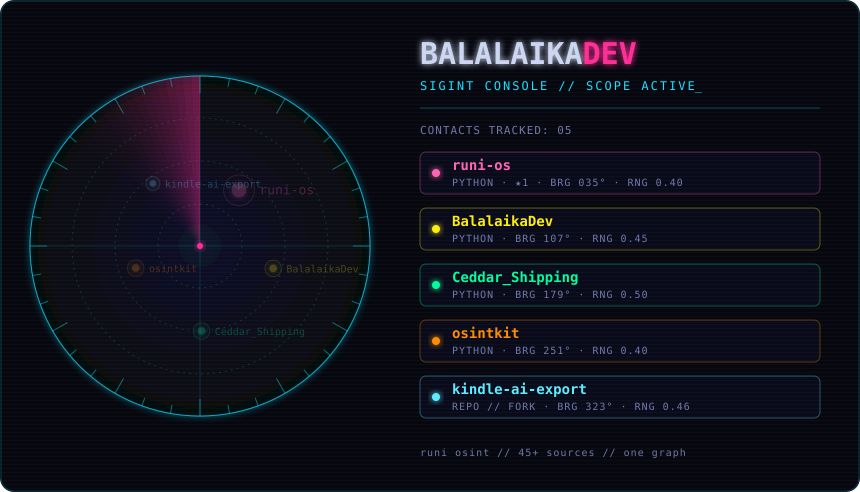
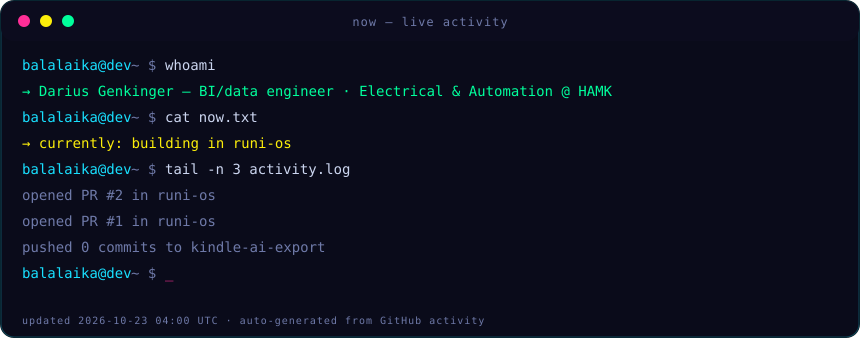

  

<!-- LEGEND:START -->

  contacts (click to open): 
  
  
  
  
  

<!-- LEGEND:END -->

<h1 align="center">Darius Genkinger</h1>

  <b>BI / Data engineer who builds.</b> 
  Electrical &amp; Automation Engineering student @ HAMK · based in Finland 🇫🇮 
  Power BI · DAX · Python · FastAPI · building data systems that keep running on their own

  
  
  
  
  
  

  <b>💼 Open to working-student, internship &amp; data/BI roles — remote, or on-site in Finland 🇫🇮 / Germany 🇩🇪</b>

  
  &nbsp;
  

---

### What I do

I turn messy, multi-source data into clear, decision-ready reporting — and then into systems that **keep working without maintenance**. Over 2024–2026 I worked with **KALDEWEI** (Germany), first in Controlling &amp; Data Analysis internships and then as a freelance Power BI developer: a self-updating demand-forecasting model, multi-source sales data fused into clean reporting, and a round of report modernization.

Alongside the BI work I build full-stack software — the kind most analysts don't ship and most developers don't pair with real data experience. That overlap is the point.

### Currently

Studying Electrical &amp; Automation Engineering, and building out this GitHub as the code-side companion to the data work. Open to **working-student, internship, and data/BI roles** — remote, or on-site in Finland or Germany.

<!-- NOW:START -->

  

<!-- NOW:END -->

### Selected projects

<!-- PROJECTS:START -->
<!-- This table is auto-generated from GitHub by scripts/update_readme.py. -->
| Project | What it is |
| --- | --- |
| **[runi-os](https://github.com/BalalaikaDev/runi-os)** | Self-hosted OSINT &amp; data platform — 45+ intelligence sources fused into one provenance-tracked Neo4j graph, an AI investigation engine, and a modular dashboard. `Python` · ★1 |
| **[osintkit](https://github.com/BalalaikaDev/osintkit)** | A uniform async interface over free and keyed OSINT data sources. `Python` |
| **[kindle-ai-export](https://github.com/BalalaikaDev/kindle-ai-export)** | Export any Kindle book you own. `TypeScript` · fork |
| **[Ceddar_Shipping](https://github.com/BalalaikaDev/Ceddar_Shipping)** | Learn Python by running a shipping empire. `Python` |
| **[BalalaikaDev](https://github.com/BalalaikaDev/BalalaikaDev)** | This profile itself — the radar banner, live "now" card and this very table all regenerate from GitHub on a schedule. `Python` |
| _data pipeline_ | _Coming soon — an automated, self-refreshing analytics pipeline (ingest → model → forecast → dashboard)._ |
<!-- PROJECTS:END -->

### Hire me

I'm looking for working-student, internship, and data/BI roles (remote, or on-site in Finland / Germany). The fastest way to reach me:

  
  &nbsp;
  

